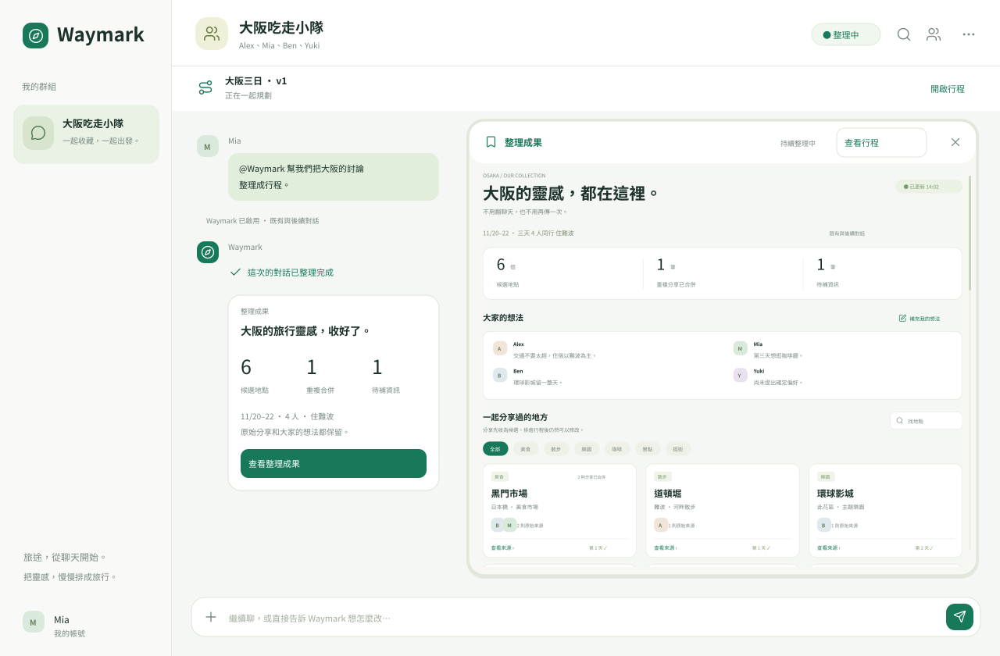

# Waymark｜群組旅遊 Bot

[直接開啟線上原型](https://yiguo12.github.io/waymark-travel-bot/)

讓朋友在原本的群組自然討論，把零散分享整理成可以一起確認、修改的旅行安排。



## 體驗方式

開啟 `index.html`，按「讓 Waymark 幫忙整理」，或在聊天裡輸入 `@Waymark`。

1. 選擇從現在開始，或整理群組已提供的歷史對話。
2. 選項立即關閉，聊天裡顯示整理狀態。
3. 完成後，自動在同一個對話中展開整理成果。
4. 查看分享來源、補充待確認資訊，或打開行程調整時間、順序與地點。
5. 收起視窗後，訊息與成果卡片持續保留；結束規劃才會保存並停止擷取。

`results.html` 會直接開啟整理完成的代表情境，方便檢視成果。兩個入口都保留聊天介面及輸入框。

## 功能

- 群組聊天與 Bot 呼叫、讀取範圍選擇。
- 地點分類、搜尋、重複內容合併與原始來源。
- 旅伴偏好、待補地點與修正紀錄。
- 三日行程、候選清單、時間與順序編輯。
- 聊天提出修改，查看差異後再套用。
- 個別版本確認、保存停止與再次查看。
- 下載 `.ics` 行事曆；同一瀏覽器盡可能保留本機操作狀態。

## 本機執行

無外部套件或後端需求，可以直接用瀏覽器開啟根目錄的 HTML。

若要以本機伺服器查看：

```sh
python3 -m http.server 8000
```

再開啟 `http://localhost:8000/`。

修改 `src/` 後，使用 Python 3 重建；若已安裝 Node.js，也會產生可立即檢視的初始畫面：

```sh
python3 scripts/build.py
```

使用 Node.js 18 以上執行主要互動邏輯檢查：

```sh
npm test
```

## 專案結構

| 路徑 | 用途 |
|---|---|
| `index.html` | 完整 Bot 原型入口 |
| `results.html` | 直接查看整理成果 |
| `src/` | 介面、樣式、圖示資料與互動邏輯 |
| `scripts/` | 無套件依賴的建置與初始內容產生工具 |
| `tests/` | 範圍選擇、自動展開、資料邊界與結果處理檢查 |
| `assets/` | 設計預覽與外部 User Flow 文件 |
| `figma/` | Figma 固定代表情境的本地匯入套件 |

User Flow 是設計參考，不會顯示在 App 介面裡。

## 展示範圍

這是前端互動原型。AI 回覆採固定規則及示範情境，未連接真實 LINE、AI 模型、多人同步或個人日曆帳戶。朋友訊息、歷史資料、來源與行程均為示範資料。

「全部對話」只使用這次已提供的資料，不代表 LINE Bot 可以任意回讀加入前的群組歷史。交通、營業時間與票券尚未查核。確認只代表目前使用者 Mia 的同意，不會替其他旅伴確認。

已檢查主要操作邏輯；尚未完成所有瀏覽器與裝置的實測。設計預覽為向量匯出，不是瀏覽器截圖。Figma 匯入套件為固定代表畫面，尚未在 Figma 內執行驗證。

## 圖示

使用 [Lucide](https://lucide.dev/) 圖示，採 ISC 授權；授權文字見 `THIRD_PARTY_NOTICES.md`。
